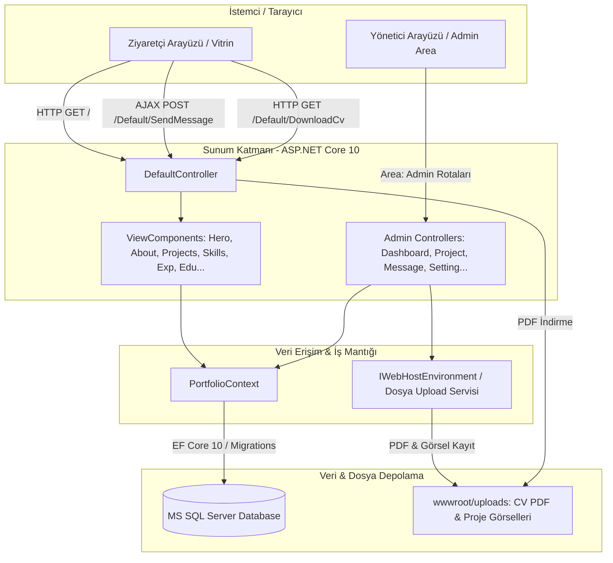
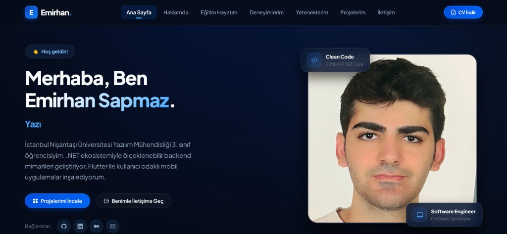
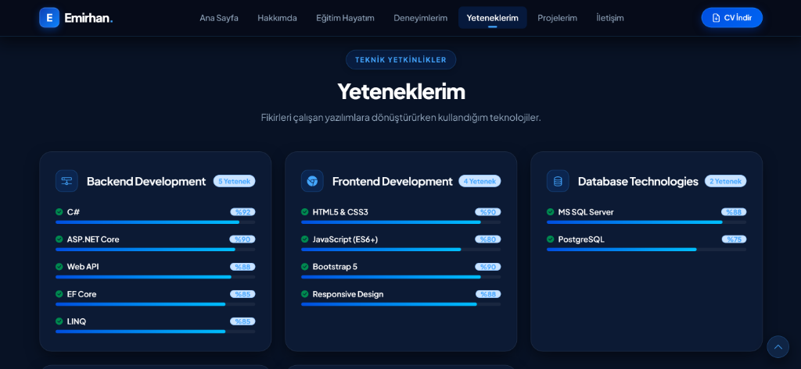
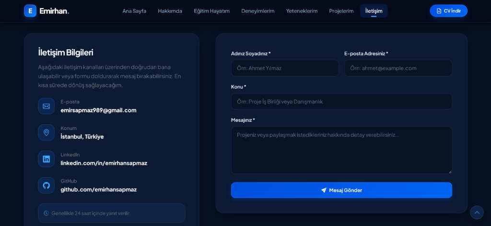
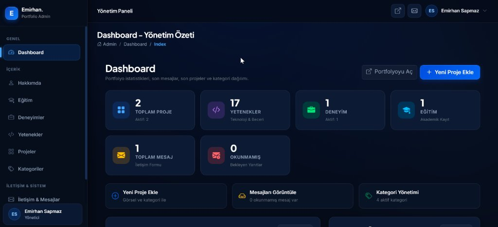
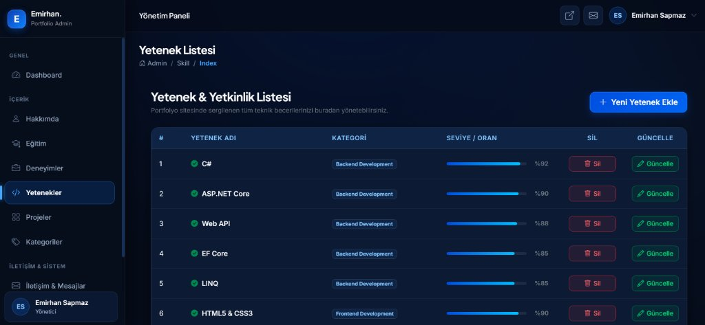
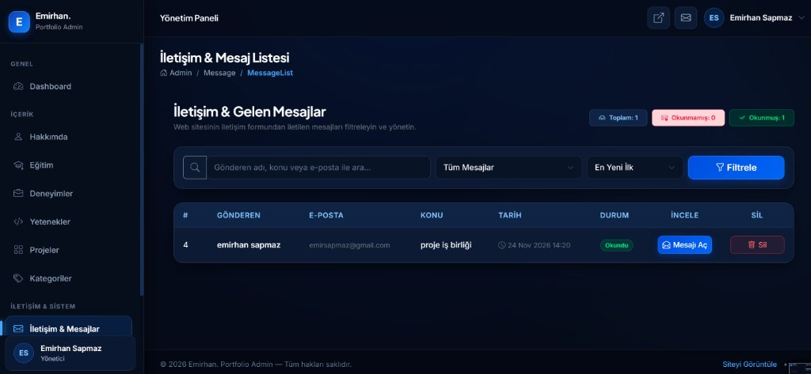

# 🚀 Full-Stack .NET 10 Portfolio & Yönetim Sistemi

<div align="center">


<br/>

**Modern, dinamik, yüksek performanslı ve kapsamlı bir ASP.NET Core 10 MVC Portfolyo & Admin Yönetim Paneli Çözümü.**

[🌐 Canlı Önizleme](#-arayüz-ve-ekran-görüntüleri) • [✨ Özellikler](#-temel-özellikler) • [🏗️ Mimari](#-sistem-mimarisi) • [⚙️ Kurulum](#-kurulum-ve-çalıştırma) • [📬 İletişim](#-geliştirici--iletişim)

</div>

---

## 📖 İçindekiler
- [Proje Hakkında](#-proje-hakkında)
- [Temel Özellikler](#-temel-özellikler)
  - [Kullanıcı Arayüzü (Public Portfolio)](#1-kullanıcı-vitrini-public-frontend)
  - [Yönetim Paneli (Admin Dashboard)](#2-yönetim-paneli-admin-panel)
- [Teknoloji Yığını](#-teknoloji-yığını)
- [Sistem Mimarisi](#-sistem-mimarisi)
- [Proje Klasör Yapısı](#-proje-klasör-yapısı)
- [Veritabanı Şeması ve Varlıklar](#-veritabanı-şeması-ve-varlıklar)
- [Öne Çıkan Teknik Çözümler](#-öne-çıkan-teknik-çözümler)
- [Yönetim Paneli Sayfa Haritası](#-yönetim-paneli-sayfa-haritası)
- [Arayüz ve Ekran Görüntüleri](#-arayüz-ve-ekran-görüntüleri)
- [Kurulum ve Çalıştırma](#-kurulum-ve-çalıştırma)
- [Geliştirici & İletişim](#-geliştirici--iletişim)
- [Lisans](#-lisans)

---

## 💡 Proje Hakkında

**MY Academy Portfolio 2**, modern web standartları ve kurumsal mimari prensipleri doğrultusunda geliştirilmiş profesyonel bir portfolyo ve içerik yönetim platformudur.

Proje, yazılım mühendisliği yetkinliklerini, deneyimleri, tamamlanan projeleri ve akademik geçmişi etkileyici bir vitrinde sunarken; arka planda **ASP.NET Core 10**'un en güncel özelliklerini, **Entity Framework Core 10** Code-First yaklaşımını ve kurumsal **Area** tabanlı bir yönetim panelini bir araya getirir.

### 🎯 Projenin Öne Çıkan Avantajları
- **Tamamı Dinamik İçerik:** Portfolyoda yer alan her metin, proje, deneyim, yetenek ve dosya veritabanından yönetilir.
- **Modern UI / UX:** Karanlık tema (Dark Navy) admin paneli ve soft geçişli, cam efekti (Glassmorphism) barındıran ziyaretçi vitrini.
- **Asenkron İletişim:** Sayfa yenilenmeksizin çalışan AJAX tabanlı iletişim formu.
- **Gelişmiş Dosya Yönetimi:** Gerçek zamanlı CV (PDF) ve proje görselleri için dosya tipi ve boyut denetimli upload altyapısı.

---

## ✨ Temel Özellikler

### 1. Kullanıcı Vitrini (Public Frontend)
* **Hero & Typing Animasyonu:** Sayfa açılışında ziyaretçiyi karşılayan, Vanilla JS ile geliştirilmiş kesintisiz metin yazma (typing) animasyonu.
* **Teknoloji Kayan Şerit (Infinite Marquee):** Kullanılan modern teknolojileri akıcı bir sonsuz döngüyle sergileyen teknoloji bantı.
* **Hakkımda & Yetkinlikler:** Dinamik profil detayları, iş arayış durumu rozeti ve kategoriye göre gruplanmış yüzdelik yetenek barları.
* **Etkileşimli Proje Filtreleme:** Kategori bazlı (Web, Masaüstü, API, Mobil vb.) JavaScript ile anlık proje filtreleme sistemi.
* **Tarihçeli Deneyim & Eğitim Zaman Tüneli:** Kronolojik ve görsel olarak zenginleştirilmiş geçmiş dökümü.
* **Dinamik CV İndirme:** Yönetim panelinden yüklenen en güncel özgeçmişi otomatik olarak algılayıp indiren `DownloadCv` servisi.
* **AJAX İletişim Formu:** Client-side ve Server-side validasyon denetimleriyle güvenli, anlık bildirimli mesaj iletimi.
* **Scrollspy & Başa Dön:** Sayfa kaydırıldıkça dinamik güncellenen menü ve akıcı yukarı kaydırma butonu.

### 2. Yönetim Paneli (Admin Panel)
* **İstatistik ve KPI Dashboard'u:** 
  - Toplam proje, yetenek, deneyim, eğitim, mesaj ve kategori sayaçları.
  - Okunmuş / Okunmamış mesaj oranları.
  - Kategori bazında proje dağılım yüzdeleri.
  - Son eklenen 3 proje ve gelen son 5 mesajın anlık özeti.
* **Proje Yönetimi (CRUD + Upload):** Proje ekleme, düzenleme, silme, arama ve kategoriye göre filtreleme. `IFormFile` ile 5MB sınırlandırmalı görsel yükleme altyapısı.
* **Mesajlaşma & Bildirim Merkezi:** Gelen mesajları listeleme, metin araması, okunma durumuna göre filtreleme (Okundu/Okunmadı), tarihe göre sıralama ve tek tıkla durum güncelleme.
* **Özgeçmiş (CV) Yönetim Modülü:** Yalnızca `.pdf` formatını ve en fazla 10MB boyutunu kabul eden, dosya adı standartlaştırılmış ve anında yayına giren dinamik CV yükleme alanı.
* **Yetenek & Kategori Yönetimi:** Yetenek yüzdeleri, kategorizasyon ve dinamik kategori oluşturma/güncelleme modülleri.
* **Deneyim & Eğitim Yönetimi:** Çalışma türü (Full-time, Remote, Hybrid) ve aktiflik durumunun dinamik yönetimi.
* **Site Ayarları & Profil:** Biyografi, unvan, sosyal medya ve açık iş fırsatı bilgilerinin tek merkezden yönetimi.

---

## 🛠️ Teknoloji Yığını

### Backend
| Teknoloji | Sürüm | Açıklama |
|---|---|---|
| **.NET SDK** | `10.0` | En güncel .NET çalışma zamanı ve web barındırma |
| **C#** | `13.0` | Modern dil özellikleri, Pattern Matching, Record tipleri |
| **ASP.NET Core MVC** | `10.0` | Controllers, Views, ViewComponents, Routing |
| **Entity Framework Core** | `10.0.15` | ORM, Code-First, Veritabanı Migrasyonları |
| **LINQ & Raw SQL** | - | Yüksek performanslı veri filtreleme, GroupBy ve özet sorguları |

### Veritabanı
| Teknoloji | Açıklama |
|---|---|
| **Microsoft SQL Server** | İlişkisel veritabanı motoru (`PortfolioDbNight2`) |
| **EF Core Migrations** | Şema versiyon kontrolü ve otomatik migration / seed desteği |

### Frontend & Tasarım
| Bileşen | Detay |
|---|---|
| **Bootstrap 5.3.3** | Responsive Grid, Modern UI Bileşenleri |
| **Bootstrap Icons 1.11.3** | Zengin vektörel ikon seti |
| **Google Fonts** | `Plus Jakarta Sans` & `Inter` tipografisi |
| **Vanilla JavaScript (ES6+)** | Typing animation, Scrollspy, AJAX Fetch API, Dinamik filtreleme |
| **CSS3 & Glassmorphism** | CSS değişkenleri, Ambient Blobs, Dark Navy tema paleti |

---

## 🏗️ Sistem Mimarisi

Aşağıdaki şema, sistemin bileşenler arası veri akışını ve mimari organizasyonunu göstermektedir:



---

## 📂 Proje Klasör Yapısı

```plaintext
MY_Academy_Portfolio2/
├── Areas/
│   └── Admin/                               # Yönetim Paneli Alanı (Area)
│       ├── Controllers/                     # Admin CRUD Denetleyicileri
│       │   ├── AboutController.cs           # Hakkımda bilgileri yönetimi
│       │   ├── CategoryController.cs        # Kategori yönetimi
│       │   ├── DashboardController.cs       # KPI & istatistik analitiği
│       │   ├── EducationController.cs       # Eğitim geçmişi yönetimi
│       │   ├── ExperienceController.cs      # İş deneyimleri yönetimi
│       │   ├── MessageController.cs         # Gelen mesaj kutusu & filtreleme
│       │   ├── ProjectController.cs         # Proje CRUD & görsel yükleme
│       │   ├── SettingController.cs         # CV yükleme & sistem ayarları
│       │   └── SkillController.cs           # Yetenekler ve oranları
│       ├── ViewComponents/                  # Admin Layout parçalı bileşenleri
│       └── Views/                           # Admin Razor Sayfaları
├── Context/
│   └── PortfolioContext.cs                  # EF Core DbContext & SQL Server konfigürasyonu
├── Controllers/
│   ├── DefaultController.cs                 # Ana vitrin, CV indirme & AJAX mesaj yönetimi
│   ├── HomeController.cs                    # Varsayılan yönlendirmeler
│   └── ViewComponents/                      # Vitrin ViewComponent sınıfları
│       └── DefaultViewComponents/           # 9 farklı bağımsız UI bileşeni
├── Entities/                                # Veritabanı Varlıkları (Modeller)
│   ├── About.cs                             # Profil bilgileri modeli
│   ├── Category.cs                          # Proje kategorileri modeli
│   ├── Contact.cs                           # İletişim bilgileri modeli
│   ├── Education.cs                         # Eğitim kayıtları modeli
│   ├── Experience.cs                        # Deneyim kayıtları modeli
│   ├── HeroSection.cs                       # Karşılama bölümü modeli
│   ├── Message.cs                           # Gelen mesajlar modeli
│   ├── Project.cs                           # Projeler modeli
│   └── Skill.cs                             # Yetenekler modeli
├── Migrations/                              # EF Core Code-First veritabanı migrasyonları
├── Models/
│   ├── DashboardViewModel.cs                # İstatistik kartları ve özet DTO'su
│   └── ErrorViewModel.cs                    # Hata yakalama modeli
├── Views/
│   ├── Default/
│   │   └── Index.cshtml                     # Ana vitrin tek sayfa (Single Page) tasarımı
│   └── Shared/
│       └── Components/                      # Modüler ViewComponent Razor görünümleri
├── wwwroot/
│   ├── css/ & js/                           # Statik stil ve script dosyaları
│   └── uploads/                             # Dinamik kullanıcı yüklemeleri
│       ├── cv/                              # Yüklenen en son özgeçmiş (PDF)
│       └── projects/                        # Projelere ait kapak görselleri
├── screenshots/                             # Proje ekran görüntüleri (Vitrin & Admin)
├── Program.cs                               # Uygulama başlangıcı, DI, routing & seed logic
├── appsettings.json                         # Yapılandırma ayarları
└── MY_Academy_Portfolio2.csproj             # Proje konfigürasyonu ve NuGet paketleri
```

---

## 🗄️ Veritabanı Şeması ve Varlıklar

Proje **Code-First** yaklaşımıyla tasarlanmış olup varlıklar üzerinde güçlü `DataAnnotations` doğrulamaları barındırır:

| Varlık (Entity) | Açıklama | Önemli Alanlar |
|---|---|---|
| **`Project`** | Sergilenen yazılım projeleri | `Title`, `Description`, `GithubUrl`, `CoverImageUrl`, `CategoryId` |
| **`Category`** | Projelerin sınıflandırıldığı kategoriler | `CategoryName`, `Projects (1 - N İlişki)` |
| **`Skill`** | Teknik yetkinlikler ve teknolojiler | `Title`, `Value (0-100)`, `Category` |
| **`Experience`** | Çalışma geçmişi ve pozisyonlar | `Title`, `Company`, `Description`, `Duration`, `WorkType`, `IsActive` |
| **`Education`** | Akademik ve sertifikasyon eğitimi | `Title`, `SubTitle`, `Description`, `Duration` |
| **`Message`** | Ziyaretçilerin ilettiği mesajlar | `NameSurname`, `Email`, `Subject`, `MessageContent`, `SendDate`, `IsRead` |
| **`About`** | Biyografi ve genel tanıtım | `NameSurname`, `JobTitle`, `Location`, `Experience`, `Email`, `OpenToWork` |
| **`HeroSection`** | Açılış karşılama başlıkları | `Title`, `Subtitle`, `Description`, `ImageUrl` |
| **`Contact`** | Sosyal medya ve harita bilgileri | `Email`, `LinkedIn`, `Github`, `Location` |

---

## ⚡ Öne Çıkan Teknik Çözümler

### 1. ViewComponent Mimarisi ile Modüler UI
Geleneksel PartialView yapısı yerine, her biri kendi iş mantığına ve veri çekme operasyonuna sahip **ViewComponent** sınıfları kullanılmıştır. Bu sayede `DefaultController` temiz kalır ve vitrin bileşenleri bağımsız olarak yeniden kullanılabilir:
- `_DefaultHeroSectionComponentPartial`
- `_DefaultAboutComponentPartial`
- `_DefaultSkillComponentPartial`
- `_DefaultProjectComponentPartial`
- `_DefaultExperienceComponentPartial`
- `_DefaultEducationComponentPartial`

### 2. LINQ ile Dashboard Analitiği & Oran Hesaplamaları
`DashboardController` içinde, tek sorguda ilişkisel veriler gruplanarak kategori bazında proje oranları matematiksel olarak hesaplanır:
```csharp
var categoryStats = _context.Categories
    .Select(c => new {
        c.CategoryName,
        Count = c.Projects.Count()
    }).ToList();

var categorySummaries = categoryStats.Select(cs => new CategorySummaryItem {
    CategoryName = cs.CategoryName,
    ProjectCount = cs.Count,
    Percentage = totalProjects > 0 ? (int)Math.Round(cs.Count * 100.0 / totalProjects) : 0
}).ToList();
```

### 3. Güvenli Dosya Yükleme (MIME & Boyut Kontrolü)
Proje görselleri ve CV yüklemelerinde uzantı doğrulama ve boyut sınırlandırması uygulanmıştır:
- **Görseller:** `.jpg`, `.jpeg`, `.png`, `.webp`, `.svg` formatları kontrol edilir; maksimum 5 MB sınırı bulunur.
- **Özgeçmiş:** Yalnızca `.pdf` kabul edilir; maksimum 10 MB sınırı denetlenir ve `emirhan-sapmaz-cv.pdf` adıyla güvenli bir şekilde saklanır.

### 4. Asenkron AJAX Mesaj Gönderimi
Ziyaretçiler formu doldurduğunda tarayıcı yenilenmez; `fetch` API ile istek arka planda işlenir:
```javascript
fetch('/Default/SendMessage', {
    method: 'POST',
    body: formData,
    headers: { 'X-Requested-With': 'XMLHttpRequest' }
})
.then(res => res.json())
.then(data => {
    if(data.success) { /* Başarı uyarısını göster ve formu temizle */ }
});
```

---

## 🗺️ Yönetim Paneli Sayfa Haritası

| Modül | URL Yolu | Açıklama |
|---|---|---|
| **Dashboard** | `/Admin/Dashboard/Index` | Sistem özeti, sayaçlar, son projeler ve mesajlar |
| **Hakkımda** | `/Admin/About/Index` | Kişisel biyografi ve profil detaylarını güncelleme |
| **Projeler** | `/Admin/Project/Index` | Proje listesi, görsel yüklemeli ekleme ve düzenleme |
| **Kategoriler** | `/Admin/Category/Index` | Proje kategorilerini listeleme, ekleme ve silme |
| **Yetenekler** | `/Admin/Skill/Index` | Teknik yetenekleri ve oranlarını yönetme |
| **Deneyimler** | `/Admin/Experience/ExperienceList` | Pozisyon, şirket ve aktiflik durumu yönetimi |
| **Eğitim** | `/Admin/Education/Index` | Okul, derece ve tarih aralıkları yönetimi |
| **Mesaj Kutusu** | `/Admin/Message/MessageList` | Gelen mesajları okuma, yanıtlama ve silme |
| **Ayarlar & CV** | `/Admin/Setting/Index` | PDF formatında yeni CV yükleme ve dosya durumu |

---

## 📸 Arayüz ve Ekran Görüntüleri

### 🌟 1. Kullanıcı Vitrini (Public Portfolio)

#### 🔹 Hero & Karşılama Bölümü
> Ziyaretçileri karşılayan modern koyu tema arayüzü; JavaScript daktilo (typing) animasyonu, dinamik biyografi, doğrudan iletişim ve proje yönlendirme butonları (CTA), navbar üzerinde dinamik **CV İndir** servisi ile süzülen *"Clean Code (C# & ASP.NET Core)"* ve *"Software Engineer"* yetkinlik rozetleri.

<div align="center">
  
</div>

<br/>

#### 🔹 Teknik Yetkinlikler (Skills Section)
> Veritabanında tanımlı yeteneklerin alanlarına göre (**Backend Development**, **Frontend Development**, **Database Technologies**) otomatik gruplandığı, her teknolojinin yüzde seviyesini ve animasyonlu ilerleme çubuğunu sergileyen dinamik modül.

<div align="center">
  
</div>

<br/>

#### 🔹 İletişim Bilgileri & AJAX Mesaj Formu
> Sol alanda e-posta, lokasyon, LinkedIn ve GitHub profilleri ile ortalama yanıt süresi rozeti yer alır. Sağ alanda ise sayfa yenilenmeksizin çalışan, hem istemci hem de sunucu taraflı validasyon denetimlerine sahip, anlık geri bildirim üreten asenkron AJAX iletişim formu bulunmaktadır.

<div align="center">
  
</div>

---

### 📊 2. Yönetim Paneli (Admin Area - Dark Dashboard)

#### 🔹 Yönetim Özeti & KPI Dashboard
> Sistem durumunun anlık izlendiği yönetici ana sayfası; toplam proje, aktif yetenek, deneyim, eğitim ve okunmamış mesaj sayaçlarını içeren KPI kartları ile tek tıkla yeni proje ekleme veya portfolyoyu önizleme kısayolları.

<div align="center">
  
</div>

<br/>

#### 🔹 Yetenek & Beceri Yönetim Merkezi
> Portfolyoda sergilenen tüm teknik becerilerin listelendiği yönetim tablosu. Yeni yetenek tanımlama, yüzde oranlarını ve kategorileri anlık güncelleme ve silme operasyonları buradan gerçekleştirilir.

<div align="center">
  
</div>

<br/>

#### 🔹 İletişim & Gelen Mesaj Kutusu
> Ziyaretçilerin ilettiği mesajların yönetildiği gelen kutusu; dinamik metin araması, okunma durumu filtresi (Tüm Mesajlar / Okunmuş / Okunmamış), tarih sıralaması ve mesaj detayını açıp anında durumunu "Okundu" olarak işaretleyen aksiyon altyapısı.

<div align="center">
  
</div>

---

## ⚙️ Kurulum ve Çalıştırma

Projeyi yerel geliştirme ortamınızda çalıştırmak için aşağıdaki adımları takip edebilirsiniz:

### 1. Ön Gereksinimler
* [.NET 10.0 SDK](https://dotnet.microsoft.com/download) yüklü olmalıdır.
* [Microsoft SQL Server](https://www.microsoft.com/sql-server) veya LocalDB kurulu olmalıdır.
* [Visual Studio 2022 / 2026](https://visualstudio.microsoft.com/) veya [VS Code](https://code.visualstudio.com/).

### 2. Projeyi Klonlayın
```bash
git clone https://github.com/emirhansapmaz/MY_Academy_Portfolio2.git
cd MY_Academy_Portfolio2
```

### 3. Veritabanı Bağlantısını Yapılandırın
`Context/PortfolioContext.cs` dosyasındaki connection string'i kendi yerel SQL Server örneğinize göre düzenleyin:
```csharp
optionsBuilder.UseSqlServer("Server=YOUR_SERVER_NAME;Database=PortfolioDbNight2;integrated security=true;trust server certificate=true");
```

### 4. Veritabanı Migrasyonlarını Uygulayın
Visual Studio **Package Manager Console** üzerinden:
```powershell
Update-Database
```
Veya **.NET CLI** ile terminal üzerinden:
```bash
dotnet ef database update
```
> **Not:** `Program.cs` içerisinde otomatik tablo kontrolü ve varsayılan yetenek kayıtlarını ekleyen seed mekanizması bulunmaktadır.

### 5. Uygulamayı Başlatın
```bash
dotnet run
```
* **Kullanıcı Vitrini:** `https://localhost:7045/` (veya `http://localhost:5000`)
* **Yönetim Paneli:** `https://localhost:7045/Admin/Dashboard/Index`

---

## 👨‍💻 Geliştirici & İletişim

**Emirhan Sapmaz**  
*Bilgisayar Mühendisi & Full Stack .NET Developer*

<div align="left">

[](https://www.linkedin.com/in/emirhan-sapmaz-8704153a9/)
[](https://github.com/emirhansapmaz)
[](mailto:emirsapmaz989@gmail.com)

</div>

---

## 📄 Lisans

Bu proje eğitim ve kişisel portfolyo amacıyla hazırlanmıştır. [MIT Lisansı](LICENSE) kapsamında serbestçe incelenebilir ve referans alınabilir.

<div align="center">
  <sub>❤️ Bu proje Emirhan Sapmaz tarafından modern teknolojilerle geliştirilmiştir.</sub>
</div>
